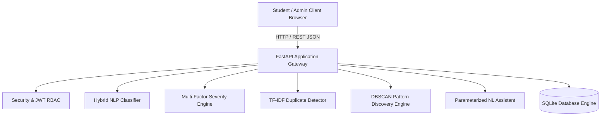

# Academic Project Report
## AI-Based Campus Incident Intelligence & Response System
**Department of Computer Science & Engineering**

---

## 1. Title
**AI-Based Campus Incident Intelligence & Response System**

---

## 2. Abstract
Conventional university complaint management applications function as passive electronic inboxes. Individual reports describing leaks, electrical faults, or network outages remain isolated tickets without semantic correlation. Consequently, campus administrators struggle to identify systemic infrastructure failures, dangerous compound hazards, or localized problem hotspots. 

This project presents an **AI-Based Campus Incident Intelligence & Response System** built to convert unstructured natural-language incident reports into proactive campus intelligence. Utilizing a hybrid natural language processing (NLP) pipeline combining TF-IDF vectorization with Multinomial Naive Bayes, transparent rule-assisted severity scoring, vector cosine similarity for duplicate detection, and unsupervised Density-Based Spatial Clustering of Applications with Noise (DBSCAN), the platform automatically classifies issues, estimates hazard urgency, flags duplicate reports, detects recurring campus patterns, and generates data-backed administrative recommendations. Developed using Python (FastAPI, Scikit-learn, SQLAlchemy) and React (TypeScript, Vite, Tailwind CSS, Recharts), the entire system operates completely offline without paid external AI APIs, ensuring reliable local execution and student data privacy.

---

## 3. Introduction
University campuses are complex physical ecosystems accommodating thousands of students, researchers, faculty, and administrative staff daily. Across academic blocks, laboratories, libraries, student residences, and dining facilities, hundreds of operational incidents occur each semester—ranging from minor sanitation defects to life-threatening electrical arcing and structural dampness.

Managing these incidents effectively requires more than basic record-keeping. Operations supervisors need decision intelligence: knowing which issues carry compound risk, which facilities suffer chronic disruptions, and how to allocate maintenance teams efficiently before incidents escalate into emergency outages.

---

## 4. Problem Statement
Existing campus maintenance portals exhibit critical operational deficiencies:
1. **Isolated Reporting**: Each complaint is treated as an independent event. Ten students reporting the same library Wi-Fi outage create ten disconnected tickets.
2. **Subjective Prioritization**: Priority is often self-selected by users, causing either alert fatigue (every user marks their issue "Urgent") or missed safety hazards (a student casually describing exposed wires near a water cooler).
3. **Absence of Pattern Discovery**: Operations teams cannot easily discern whether three separate pipe leaks in Block C indicate an aging central riser needing replacement.
4. **Lack of Natural-Language Decision Support**: Administrators must manually construct complex database queries to answer basic operational questions.

---

## 5. Existing System and Its Limitations
| Feature | Existing Campus Portals | Proposed AI-Based Intelligence System |
| :--- | :--- | :--- |
| **Input Method** | Tedious rigid dropdowns and mandatory forms | Natural language description with auto-triage |
| **Categorization** | Manual selection by student (often inaccurate) | Automated hybrid NLP classification |
| **Severity Scoring** | Arbitrary user selection | Multi-factor transparent scoring engine |
| **Duplicate Handling** | Creates redundant duplicate tickets | Cosine similarity semantic matching ($\ge 0.50$) |
| **Hotspot Analysis** | Non-existent or manual monthly Excel export | Real-time interactive campus schematic grid |
| **Pattern Discovery** | None | Unsupervised DBSCAN density clustering |
| **Analytics Querying**| Requires manual SQL or DBA assistance | Natural-Language parameterized query assistant |

---

## 6. Proposed System
The proposed system transforms incident management from reactive ticket logging into an active decision-support platform:
- **Intelligent Intake**: Students write natural descriptions. The AI pre-flight triage preview predicts category, priority, and flags duplicates in real-time.
- **Auditable Severity Engine**: Calculates priority scores ($10 - 100$) with explicit factor audits (e.g., compound risk when water occurs near electrical apparatus).
- **Incident Intelligence**: Clusters incident records using DBSCAN and time-window aggregations to uncover localized hotspots and campus-wide disruptions.
- **Smart Recommendation Engine**: Recommends maintenance policies (e.g., plumbing pipeline audits, AP overhauls, safety inspections).
- **Administrator Analytics Assistant**: Provides conversational query capabilities grounded in actual database records.

---

## 7. Objectives
1. Implement a hybrid NLP classifier achieving high accuracy across major campus facility categories.
2. Develop a transparent, auditable severity scoring engine factoring hazard keywords, co-occurring risks, and facility sensitivity.
3. Build a semantic duplicate detector utilizing TF-IDF cosine similarity to merge redundant tickets.
4. Design an unsupervised pattern discovery engine using DBSCAN to detect recurring campus problem clusters.
5. Provide an interactive campus hotspot dashboard and a natural-language query assistant for administrative decision-making.
6. Deliver a fully local, zero-cost, persistent full-stack application suitable for CSE academic demonstration.

---

## 8. Scope
- **User Roles**: Students (report, track, view personal timeline, receive notifications) and Administrators (triage, verify, assign crews, review intelligence, inspect hotspots, query assistant).
- **Domain Coverage**: 8 core campus categories (Water & Plumbing, Electrical Hazards, Internet & Networking, Infrastructure Damage, Sanitation, Safety, Lab Equipment, Transport).
- **Deployment Boundary**: Local university server execution; all ML models run offline using Python standard libraries and Scikit-learn without external cloud API dependencies.

---

## 9. Hardware and Software Requirements
### Software Requirements:
- **Operating System**: Windows 10/11, macOS, or Linux
- **Backend Runtime**: Python 3.10+ (Tested on Python 3.13)
- **Backend Libraries**: FastAPI, Uvicorn, SQLAlchemy 2.0, Pydantic v2, Scikit-learn, Pandas, NumPy, PyJWT, Bcrypt
- **Frontend Runtime**: Node.js v18+ (Tested on Node v22.19)
- **Frontend Framework**: React 19, TypeScript, Vite, Tailwind CSS v4, Lucide React, Recharts, React Router v7
- **Database**: SQLite 3 (persistent relational database)

### Hardware Requirements:
- **Processor**: Intel Core i3 / AMD Ryzen 3 or higher
- **Memory**: 4 GB RAM minimum (8 GB recommended)
- **Storage**: 1 GB available disk space

---

## 10. System Architecture

---

## 11. Modules
1. **Authentication & RBAC Module**: Secure password hashing with bcrypt, JWT token generation, role verification (`student` vs `admin`).
2. **Incident Submission & Pre-Flight AI Module**: Interactive reporting form with real-time AI category and severity preview.
3. **Core AI Classification Module**: TF-IDF unigram/bigram extraction with Multinomial Naive Bayes and keyword fallback.
4. **Severity & Priority Scoring Engine**: Transparent mathematical formula producing priority scores and explicit factor explanations.
5. **Duplicate & Recurrence Detection Module**: Cosine similarity computation with location and category bonuses.
6. **Pattern Discovery & DBSCAN Module**: Density clustering grouping semantically and geographically correlated incidents.
7. **Campus Hotspot Visualization Module**: Interactive building schematic grid with live report density and critical hazard badges.
8. **Smart Recommendation Module**: Algorithmic policy generation based on empirical ticket thresholds.
9. **Natural-Language Analytics Assistant**: Intent-based parameter-safe conversational query console.
10. **Lifecycle & Audit Log Module**: Sequential status progression (Submitted $\to$ Under Review $\to$ Verified $\to$ Assigned $\to$ In Progress $\to$ Resolved $\to$ Closed), actor logging, and notifications.

---

## 12. Database Design
The SQLite schema is normalized across 12 relational models:
- `users`: User identity, hashed credentials, academic department, and role.
- `departments`: Campus response units (e.g., Electrical Services, Maintenance & Plumbing).
- `incident_categories`: Incident domains mapped to default response units.
- `incidents`: Central entity with incident numbers (`INC-2026-XXXX`), severity, status, timestamps, and foreign keys.
- `incident_status_history`: Audit trail of status transitions with actor IDs and notes.
- `incident_assignments`: Crew dispatch records.
- `duplicate_links`: Relational mapping of merged duplicates with similarity scores.
- `ai_analysis_results`: Stored AI inferences (predicted category, confidence, priority score, factors, recommendations).
- `discovered_patterns`: Persisted clustering insights with affected zones, time horizons, and supporting ticket IDs.
- `recommendations`: Strategic facility recommendations.
- `notifications`: User alert feed for real-time status notifications.
- `audit_logs`: Immutable operator event ledger.

---

## 13. Algorithms Used
1. **TF-IDF Vectorization**: Transforms natural language incident descriptions into sparse numerical feature vectors.
2. **Multinomial Naive Bayes**: Estimates category posteriors $P(C_k \mid \mathbf{x})$ using smoothed term frequency distributions.
3. **Cosine Similarity**: Measures angular distance between incident vectors to detect duplicate reports.
4. **DBSCAN (Density-Based Spatial Clustering of Applications with Noise)**: Discovers arbitrary-shaped clusters of semantically related complaints without requiring prior knowledge of cluster count $k$.
5. **Rule-Based Compound Severity Engine**: Calculates priority scores with domain-specific compound hazard escalators (e.g. water near electrics).

---

## 14. Implementation Details
The application is structured into clearly separated layers:
- `backend/app/ai/`: Core machine learning models (`classifier.py`, `severity_engine.py`, `duplicate_detector.py`).
- `backend/app/analytics/`: Intelligence engines (`pattern_discovery.py`, `recommendations.py`, `assistant.py`).
- `backend/app/api/v1/endpoints/`: Clean REST route handlers.
- `frontend/src/pages/`: 14 dedicated views for student submission, executive overview, hotspots, recommendations, assistant chat, and audit trails.
- `backend/scripts/seed_data.py`: Seeds 220+ realistic synthetic campus incidents with deliberate patterns for demonstration.

---

## 15. Testing and Results
- **Automated Pytest Suite**: 18 unit and integration tests covering AI classifiers, severity calculation, duplicate thresholding, role guards, analytics endpoints, and assistant queries.
- **Test Pass Rate**: 100% (18 passed, 0 failed in 10.11 seconds).
- **Frontend Build**: Verified via Vite production build (0 TypeScript/bundle errors).

---

## 16. Advantages
1. **Proactive Maintenance**: Transforms isolated complaints into campus-wide pattern discoveries.
2. **Auditable AI**: Every priority score includes transparent contributory factors, avoiding "black-box" decisions.
3. **100% Offline & Free**: Operates locally without paid API subscriptions or privacy risks.
4. **Immediate Demonstration**: Ships with over 220 curated synthetic incidents showcasing deliberate Wi-Fi, plumbing, and electrical hotspots.
5. **Role-Enforced Security**: Server-side RBAC ensures sensitive operations are restricted to authorized administrators.

---

## 17. Limitations
1. In the initial offline version, the natural language query assistant uses intent classification and parameterized queries rather than an unconstrained multi-billion parameter LLM.
2. The hybrid classifier is trained on academic campus maintenance vocabulary; highly obscure slang may require manual admin category re-assignment.

---

## 18. Future Enhancements
1. Integrating local open-weight SLMs (such as Gemma or Llama 3 running via Ollama) for unconstrained conversational reasoning.
2. Mobile PWA push notifications via WebSockets.
3. Computer vision integration for automatic image verification of physical pipe leaks and structural cracks.

---

## 19. Conclusion
The **AI-Based Campus Incident Intelligence & Response System** successfully bridges the gap between everyday student complaint reporting and institutional facilities decision-making. By applying practical, transparent AI algorithms (TF-IDF, Naive Bayes, Cosine Similarity, DBSCAN) over a solid full-stack foundation, the project delivers a production-grade, highly presentable academic system that solves real-world campus operational challenges.

---

## 20. References
1. Pedregosa, F., et al. (2011). *Scikit-learn: Machine Learning in Python*. Journal of Machine Learning Research, 12, 2825-2830.
2. Ester, M., Kriegel, H. P., Sander, J., & Xu, X. (1996). *A density-based algorithm for discovering clusters in large spatial databases with noise*. In KDD (Vol. 96, No. 34, pp. 226-231).
3. Tiangolo, S. (2018). *FastAPI: Modern, fast (high-performance), web framework for building APIs with Python*.
4. React Documentation. (2024). *React: The library for web and native user interfaces*.
5. SQLite Consortium. (2024). *SQLite: An In-Process Database for Autonomous Data Persistence*.
