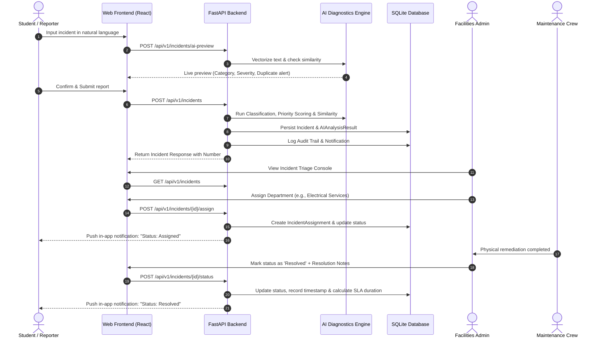

# System Architecture Specification
## AI-Based Campus Incident Intelligence & Response System

This document specifies the technical design, architectural topology, component interactions, and dataflow of the **AI-Based Campus Incident Intelligence & Response System**.

---

## 1. High-Level System Architecture Diagram

```mermaid
graph TB
    subgraph Client_Layer ["Client Layer (React 19 + TypeScript + Tailwind CSS)"]
        UI_Student["Student Portal<br/>(Incident Reporting & Status Tracking)"]
        UI_Admin["Operations Console<br/>(Triage, Hotspots, Assistant & Patterns)"]
        UI_Charts["Recharts Visualizations<br/>(14-day Trend, Severity, Hotspot Bar)"]
    end

    subgraph API_Layer ["API Gateway & Security Layer (FastAPI)"]
        FastAPI_Core["FastAPI REST Engine (:8000)"]
        JWT_Auth["JWT Token & Role-Based Access Control"]
        Static_Uploads["Secured File Upload Handler (/uploads)"]
    end

    subgraph AI_Layer ["AI & Intelligence Engine (Python 3.13 + Scikit-Learn)"]
        NLP_Classifier["Hybrid NLP Classifier<br/>(TF-IDF + Multinomial Naive Bayes)"]
        Severity_Engine["Multi-Factor Severity Engine<br/>(Compound Hazard & Location Weights)"]
        Duplicate_Detector["Duplicate Detector<br/>(TF-IDF Cosine Similarity >= 0.70)"]
        DBSCAN_Clustering["Pattern Discovery Engine<br/>(DBSCAN Semantic Density Grouping)"]
        Rec_Engine["Smart Recommendations Engine<br/>(Data-driven facilities actions)"]
        NL_Assistant["Natural-Language Query Assistant<br/>(Parameterized Safe Intent Dispatch)"]
    end

    subgraph Data_Layer ["Persistence Layer (SQLAlchemy ORM + SQLite)"]
        DB[(campus_incidents.db)]
        T_Users["Users & Roles"]
        T_Incidents["Incidents (220+ Records)"]
        T_AI["AI Analysis Results"]
        T_Patterns["Discovered Patterns"]
        T_Recs["Recommendations"]
        T_History["Status History & Audit Logs"]
    end

    UI_Student -->|REST / JSON| FastAPI_Core
    UI_Admin -->|REST / JSON| FastAPI_Core
    UI_Charts -->|REST / JSON| FastAPI_Core

    FastAPI_Core --> JWT_Auth
    FastAPI_Core --> Static_Uploads
    FastAPI_Core --> NLP_Classifier
    FastAPI_Core --> Severity_Engine
    FastAPI_Core --> Duplicate_Detector
    FastAPI_Core --> DBSCAN_Clustering
    FastAPI_Core --> Rec_Engine
    FastAPI_Core --> NL_Assistant

    FastAPI_Core --> DB
    NLP_Classifier --> DB
    DBSCAN_Clustering --> DB
    Rec_Engine --> DB
    NL_Assistant --> DB
```

---

## 2. Incident Processing Lifecycle & Workflow

---

## 3. Component Breakdown

### A. Presentation Layer
- **Framework**: React 19 with TypeScript, bundled using Vite.
- **Styling**: Tailwind CSS v4 with bespoke institutional design tokens.
- **Icons**: Lucide React.
- **Charts & Graphs**: Recharts for dynamic time-series volume trends, severity breakdowns, and hotspot counts.
- **Routing**: React Router v7 with declarative role guards (`ProtectedRoute`, `RoleRedirect`).

### B. Application & API Layer
- **Framework**: FastAPI (high-performance asynchronous Python web framework).
- **Security**: JWT authentication (`HS256`), password hashing with `bcrypt` (12 rounds), role authorization (`student` vs `admin`).
- **Data Validation**: Pydantic v2 schemas for request parsing, query parameters, and serializable responses.
- **Interactive Documentation**: Auto-generated OpenAPI v3 spec at `/docs` and Redoc at `/redoc`.

### C. Artificial Intelligence & Analytics Layer
- **Classification**: Scikit-learn `TfidfVectorizer` (ngram range 1-2) + `MultinomialNB` calibrated with domain keyword rules.
- **Duplicate & Recurrence Detection**: Vector space cosine similarity with spatial (+0.12) and category (+0.08) boosts.
- **Pattern Discovery**: Unsupervised `DBSCAN` clustering over pairwise semantic distance matrices ($1 - \text{cosine similarity}$), combined with Pandas time-window aggregations.
- **Severity Prioritization**: Transparent scoring formula factoring category base points, compound hazard signals, location sensitivity, and recurrence counts.
- **Natural Language Assistant**: Intent classification engine mapping queries to parameterized safe SQL filters, returning structured aggregations and incident ID citations.

### D. Persistence Layer
- **Engine**: SQLite 3 via SQLAlchemy 2.0 ORM.
- **Schema Normalization**: Normalized tables for `users`, `incidents`, `incident_categories`, `departments`, `incident_assignments`, `incident_status_history`, `duplicate_links`, `ai_analysis_results`, `discovered_patterns`, `recommendations`, `notifications`, and `audit_logs`.
- **Integrity**: Foreign keys, created/updated timestamps, sequential human-readable incident numbers (`INC-2026-XXXX`).
